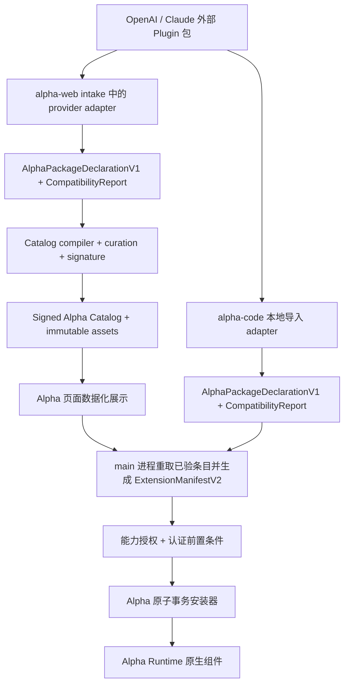

# 外部 Plugin 套件接入与 Alpha Bundle 安装

## 结论

OpenAI/Codex Plugin 与 Claude Code Plugin 应被视为**外部安装包格式**,不是 Alpha
Runtime 要模拟的第二、第三套插件 ABI。Alpha 解析外部包,把可兼容部分编译为原生
Skill、Agent、MCP、Command 投影或 OpenCode Plugin,再复用 Alpha 的验签、授权、
原子事务、收据、启停与卸载。

面向 Catalog 的新增套件,目标上只需维护一份作者级
`AlphaPackageDeclarationV1` 及其资产。它不是当前的 `ExtensionManifestV2`:
发布流水线还必须由该声明生成子 Catalog 条目、Bundle 聚合条目、资产摘要、SBOM、
intake provenance、策展结论和签名产物。**一份声明可以成为唯一作者入口,但一份
未审核、未签名的 JSON 不能绕过发布与安装安全门。**

当前实现尚未达到这一目标。现有远程 Catalog 已能让部分已知形态零 app 发版上架;
完整 OpenAI/Claude Plugin 解析器、统一作者声明、host capability 协商、富展示字段
与统一认证声明仍需实现。实现约束由
[alpha-code#215](https://github.com/jinjunnn/alpha-code/issues/215) 持有。

## 不要再混用四个“Plugin”

| 名称 | 本质 | Alpha 中的角色 |
| --- | --- | --- |
| OpenAI/Codex Plugin | `.codex-plugin/plugin.json` 描述的 Skill/MCP/Hook/资产套件 | 外部输入格式,转换后安装 |
| Claude Code Plugin | `.claude-plugin/plugin.json` 与 skills/agents/hooks/MCP 等组件目录 | 外部输入格式,转换后安装 |
| OpenCode Plugin | 实现 `@opencode-ai/plugin` 的可执行 JS 模块 | Alpha Runtime 原生 Hook/Tool ABI |
| Alpha Bundle | 多个 Alpha 原生安装单元的聚合与事务边界 | 用户看到的一键安装单元 |

OpenAI 当前把 Plugin 定义为 ChatGPT 与 Codex 共用的安装包,主要组合 Skill 与 MCP,
也可带 lifecycle hooks、连接映射和展示资产:
[Plugin architecture](https://developers.openai.com/plugins/concepts/plugins)、
[Package your plugin](https://developers.openai.com/plugins/build/plugins)。
Claude Code Plugin 当前可包含 skills、agents、hooks、MCP、LSP 与 monitors:
[Claude Plugins reference](https://code.claude.com/docs/en/plugins-reference)。

## 两条接入路径,一个规范化结果



### Catalog 路径

公开或精选套件在 alpha-web 的 intake/publish 阶段转换。这样外部格式增加可识别字段
或适配规则时,通常只更新发布工具和 Catalog,无需让所有租户先更新 alpha-code。
alpha-code 绝不相信 renderer 传来的整份条目;main 根据 `catalogId` 从已验 Catalog
重新解析,并只执行当前宿主声明支持的原语。

### 本地直接导入路径

用户选择本地目录、归档包或明确 URL 时,转换器在 alpha-code 本地运行,先显示逐组件
兼容性报告,确认后再生成安装计划。此路径若要认识一种全新的外部 schema 或组件语义,
仍需更新 alpha-code;不能从远端下载一段“转换器代码”在 main 中执行。

共享的 provider adapter 应是纯函数库:同一固定输入在 web intake 与本地导入产生
逐字节等价的声明和报告,不读取环境密钥、不执行包内脚本、不解析圈禁目录之外的路径。
adapter 的稳定 ID、版本和规则集 digest 必须进入 provenance;升级规则不能改写已经
发布版本的历史转换结果。

## 三层 Manifest,职责不能合并

| 层 | 主要作者/生成者 | 用途 | 是否含页面 | 是否含 secret 值 |
| --- | --- | --- | --- | --- |
| Provider manifest | OpenAI/Claude 第三方作者 | 描述外部包 | 可能含外部生态展示字段 | 否 |
| `AlphaPackageDeclarationV1` | Alpha 作者或 provider adapter | Alpha 的作者入口、组件与兼容性声明 | 是,仅结构化数据 | 否 |
| `ExtensionManifestV2` | alpha-code main 从已验条目生成 | 严格执行、安全与收据身份 | 否 | 否 |

当前 `ExtensionManifestV2` 只描述 `kind`、版本、平台、能力、依赖、ownership、
运行表面和 artifact 摘要。它刻意不承载安装命令、远程资产 URL、页面文案、
OAuth 配置或用户输入,所以**仅提供一份现有 ManifestV2 不能安装一份 Bundle**。

推荐把 Alpha 作者入口正式命名为 `AlphaPackageDeclarationV1`,避免把它和执行
Manifest 都称作“Bundle Manifest”。一个声明可生成一个 Bundle 与若干不可单独展示
或可单独安装的子条目。

## 标准安装方式

| 用户入口 | 输入 | 转换发生处 | 适用场景 |
| --- | --- | --- | --- |
| Catalog 一键安装 | 已签 `catalogId` | alpha-web 发布前已规范化;main 安装时复验 | 默认与推荐路径 |
| 本地目录/归档导入 | 用户明确选择的包 | alpha-code 本地纯转换器 | 私有包、开发测试、未上架包 |
| 明确 URL 导入 | 固定版本与 digest 的包 | 下载圈禁后在本地转换 | 高级用户;不得接受漂移的 `latest` |
| npm 安装 | 固定包名与版本 | 不做外部格式转换 | 仅真正实现 OpenCode ABI 的 JS Plugin |
| 单项添加/连接 | Skill、Agent 文件或 MCP 配置 | 对应单项 importer | 逃生口,不等于整包安装 |

Alpha 不应把 Claude/OpenAI Marketplace 当成一个“看到就透传安装”的可信 runtime
源。它们是发现与上游定位来源;进入 Alpha Catalog 前仍需固定版本、解析、兼容性报告、
策展、签名。这样“支持第三方生态”不会退化成“把第三方任意脚本交给 main 执行”。

## 快速集成的作者流程

目标作者体验是“一份声明、四个确定性动作”,而不是手工同时编辑 Catalog、子条目、
Bundle、摘要和签名。建议在 alpha-web 提供一个声明目录,例如
`catalog-src/packages/<package-id>/<version>/alpha-package.json`,以及等价的命令:

```text
alpha-package import <source> --format auto
alpha-package validate <alpha-package.json>
alpha-package preview <alpha-package.json>
alpha-package publish <alpha-package.json> --channel stable
```

这些命令名是目标接口,当前尚未实现。语义应固定为:

1. `import` 只解析外部包并生成声明与逐字段兼容性报告,不执行包内代码。
2. `validate` 校验 schema、路径、固定版本、许可、组件 ID、host capability 与 auth。
3. `preview` 展示最终页面数据、Bundle 扇出、能力/域名/secret 并集和被拒组件。
4. `publish` 运行 intake/curation/SBOM/provenance 门闸,生成 Catalog 与不可变资产,
   签名后才进入目标 channel。

对 Alpha 原生作者,可以直接写声明;对 OpenAI/Claude 作者,先由 provider adapter
生成声明,作者只处理 `review-required` 项。生成的 `catalog.json`、digest、SBOM、
provenance 与签名都不可手编。

## 作者声明的建议形状

下面是合同方向,不是当前已上线 schema:

```json
{
  "schema": "alpha.package.v1",
  "id": "bundle:acme-research",
  "version": "1.2.0",
  "interface": {
    "displayName": "Acme Research",
    "shortDescription": "检索并整理 Acme 工作区资料",
    "longDescription": "安装检索连接器与配套研究工作流。",
    "developerName": "Acme",
    "category": "research",
    "icon": "./assets/icon.png",
    "screenshots": ["./assets/detail.png"],
    "websiteUrl": "https://example.com",
    "privacyPolicyUrl": "https://example.com/privacy",
    "defaultPrompts": ["检索本周项目进展并生成摘要"]
  },
  "origin": {
    "format": "openai-plugin",
    "locator": "git+https://github.com/acme/research-plugin",
    "resolved": "0123456789abcdef0123456789abcdef01234567",
    "manifestDigest": "sha256:...",
    "adapter": {
      "id": "openai-plugin",
      "version": "1.0.0"
    }
  },
  "compatibility": {
    "platforms": ["darwin", "win32"],
    "requiresHostCapabilities": [
      "alpha.install.skill.v1",
      "alpha.install.mcp.remote.v1",
      "alpha.auth.mcp-oauth.v1"
    ]
  },
  "components": [
    {
      "id": "skill:acme-research",
      "kind": "skill",
      "source": "./skills/research"
    },
    {
      "id": "mcp:acme",
      "kind": "mcp",
      "transport": {
        "type": "remote",
        "url": "https://mcp.example.com"
      },
      "auth": {
        "mode": "mcp-oauth",
        "required": true,
        "scopes": ["documents.read"]
      }
    }
  ],
  "bundle": {
    "items": [
      {"componentId": "skill:acme-research", "required": true, "order": 10},
      {"componentId": "mcp:acme", "required": true, "order": 20}
    ]
  }
}
```

发布端负责把相对资产转为不可变 digest/bytes/URL,把组件展开为 Catalog 子条目,
计算能力、域名、secret、下载量、SBOM 与 provenance,并拒绝作者声明和扫描事实不一致
的包。作者不能直接填写最终签名、摘要或“已审核”结论。

## 组件兼容矩阵

`CompatibilityReport` 对每个源组件必须返回
`mapped | review-required | blocked`;未知字段同样逐项报告,不能静默丢弃。

| 外部组件 | Alpha 目标 | 默认结论 | 说明 |
| --- | --- | --- | --- |
| OpenAI/Claude Skill | Skill | `mapped` | 保留 `SKILL.md` 与圈禁的 references/scripts/assets;脚本能力另行授权 |
| Claude Agent | Agent | `review-required` | frontmatter、模型、工具与权限字段显式映射并预览 |
| Claude legacy command | Skill-backed command 投影 | `review-required` | 当前 Catalog 无一等 `command` kind;不得假装已有独立安装类型 |
| 标准本地/远程 MCP | MCP | `mapped` 或 `review-required` | 运行命令、URL、环境、OAuth 与工作区范围分别过安全门 |
| OpenAI `.app.json` | MCP connection 引用 | `review-required` | OpenAI 注册 ID 不是 Alpha 凭据;需能解析到底层 MCP/Alpha connection |
| OpenAI MCP Apps UI | MCP 的可选 UI 能力 | `blocked` 直至宿主支持 | headless MCP 可用不代表其 UI 已兼容 |
| OpenAI/Claude lifecycle hook | OpenCode Plugin hook 或拒绝 | 默认 `blocked` | 只有事件、输入输出、取消语义与权限完全等价时才能生成原生 hook |
| Claude LSP | 现有语言服务宿主或 MCP | 默认 `blocked` | 不是“复制一条 command”就等价 |
| Claude monitor/theme/output style | 无默认原语 | `blocked` | 需要新的 Alpha host capability 才能接入 |
| OpenCode JS Plugin | OpenCode Plugin | `mapped` | 必须真兼容 `@opencode-ai/plugin`,经 npm/精选资产与可执行代码授权 |
| 任意外部二进制/脚本 | 对应原生组件的 artifact | `review-required` | 固定版本与 digest,声明 runtime/capability,绝不在转换阶段执行 |

Command 有两个选择。短期沿用 ADR-014:把 Claude command 转为带斜杠入口的 Skill,
不扩 Catalog kind。若未来要独立版本、单独启停与单独收据,则正式增加
`command` kind;这属于 host schema 与安装原语变化,需要一次 app 更新。

## 正交轴

类型不是来源、来源不是分发、分发也不是认证。下列轴必须独立建模,不能再用一个
`type=plugin` 推导所有行为:

| 轴 | 示例 |
| --- | --- |
| 原生组件 | skill / agent / mcp / command 投影 / opencode-plugin / cloud |
| 聚合 | 单组件 / bundle;Bundle 不是新的运行时 |
| 外部来源格式 | alpha-native / openai-plugin / claude-plugin / opencode-npm |
| 载荷通道 | signed remote asset / npm / HTTPS MCP / connection-only / builtin snapshot |
| 运行表面 | model context / local child process / engine process / remote service |
| 能力 | 注入上下文、写配置、本机子进程、进程内代码、网络域、文件范围 |
| 认证 | none / secret input / MCP OAuth / Alpha connection |
| 激活 | default-enabled / default-disabled / session-grant |
| 策展与支持 | core / precache / connector / labs;支持层级与作者身份另算 |
| 安装范围 | Catalog 受管全局安装 / 项目本地导入;当前不得混成一条路径 |

这组正交轴让“OpenAI 来源的 Skill”“Claude 来源的 MCP”“npm 分发的 OpenCode
Plugin”“带 OAuth 的 Bundle”都能复用同一安装器,而不是每多一个生态就新增一套
特殊页面和特殊账本。

## 页面由 Manifest 承载到什么程度

Extension Hub 的详情页应继续是 Alpha 自有、数据驱动的固定页面。作者声明可以承载
经过 schema 校验的:

- 名称、短/长描述、作者、分类、图标、截图、网站与隐私/条款链接;
- 组件清单、默认提示词、版本、来源与许可;
- 能力、网络域、运行依赖、下载量、支持层级和所需认证的**摘要**。

作者声明不得承载:

- Extension Hub 内任意 HTML、React/JS 或远程 iframe;
- 任意 shell 形式的“安装步骤 UI”;
- token、client secret、cookie、refresh token 或用户账号数据;
- 绕过 Alpha 确认框的默认授权决定。

因此,新增一个只使用现有展示字段的 Bundle 不需要新的“Bundle 页面”,通用详情页会
按数据渲染。要新增截图轮播、交互式配置向导或 MCP Apps UI 等**新的页面组件能力**,
老 app 不会自动学会渲染,需要先增加对应 host capability。即便未来支持 MCP Apps UI,
它也应在隔离的 MCP UI 容器中运行,不能成为 Catalog 详情页的任意代码入口。

## Token、OAuth 与权限

必须把三件事分开:

1. **安装能力授权**:这个组件能否写配置、启动本机进程、注入上下文或执行 JS。
2. **服务认证**:用户如何向 GitHub、Notion 或私有 MCP 证明身份。
3. **运行时工具权限**:连接成功后哪些 MCP tools 可自动或逐次获准。

### API token / secret

Catalog 只声明 secret 的稳定 ID、展示标签、是否必填、用途和注入目标,永不下发值。
renderer 只收集用户输入;main 校验声明后把值写入系统 Keychain 或 Alpha 的安全文件
通道,引擎配置只得到 `{file:...}` 等引用。secret 名称必须来自已验声明,renderer
不能临时发明环境变量名。收据只记录 secret 引用 ID 与状态,不记录值或值的摘要。

### OAuth / OIDC / MCP authorization

远程 MCP 优先遵循 MCP Authorization/OAuth 2.1 discovery,由 main 控制浏览器跳转、
PKCE、回调和 token 存储。OpenAI 官方也把认证定义在 MCP 集成中,而不是把 token
塞进 Plugin manifest:
[Authentication for Plugins](https://developers.openai.com/plugins/build/auth)。

外部包里的 OpenAI `.app.json` 注册 ID 只在 OpenAI 宿主有意义,不能当作 Alpha 的
OAuth client、access token 或通用连接 ID。适配器必须取得可移植的底层 MCP 端点和
标准认证元数据;取不到就标 `review-required` 或 `blocked`,由 Alpha 单独登记
connection handler 后再上架。

Catalog 不应允许第三方随意声明一个本机 callback command 或 token exchange 脚本。
非标准 OAuth 只能引用 app 内已经审核注册的 `connectionHandlerId`;增加一种新的
专有登录处理器需要 app 更新。

### Bundle 安装与认证的事务边界

本地文件、配置、账本、授权收据和可回滚 secret 文件可以属于同一 Alpha 安装事务。
OAuth consent 是外部系统副作用,无法诚实地和本地磁盘做分布式原子回滚,所以它是
用户拥有的独立 Connection:

- 必需连接在安装前建立或复用,安装事务只绑定 `connectionId`;
- 用户取消认证时零安装副作用;
- 后续安装失败时连接仍保留并明确显示为可复用连接,不谎称已经“回滚远端授权”;
- 可选连接可在安装后保持“已安装、未连接”,但不得显示为可用。

## 什么时候只更新 alpha-web

结论不是“任何新 Bundle 都零发版”,而是“只要它落在老 app 已声明支持的合同闭包内,
就零发版”。

| 变化 | 是否需要 alpha-code 更新 |
| --- | --- |
| 新名称、描述、图标、已支持的组件组合 | 否 |
| 新 Skill 或已支持配置形态的 MCP | 否 |
| 新 Bundle 只聚合事务安装器已支持的子项 | 否 |
| 更新固定版本、digest、策展结论、下架或安全公示 | 否 |
| 新外部 provider 字段,但已由 alpha-web 转成现有 Alpha 原语 | 否 |
| 本地直接导入要识别新的 provider schema | 是 |
| 新 Catalog/Declaration schema 且老 app 不认识 | 是 |
| 新 kind、安装 action、capability 或运行表面 | 是 |
| Bundle 加入老安装器不能原子处理的子项 | 是 |
| 新 OAuth 专有处理器、新页面组件、MCP Apps UI 宿主 | 是 |
| OpenCode Plugin ABI 或验签信任根变化 | 是 |

每个发布条目必须携带 `requiresHostCapabilities`。alpha-code 只展示/安装自身完整支持
的条目;缺一个 token 就显示“需要更新 Alpha”而不是尝试半装。能力 token 必须按行为
版本化,例如 `alpha.install.bundle.agent.v1`,不能只写一个无法协商的 app 最低版本。

## 当前真实边界

截至本文件复核时:

- alpha-web 已是 Catalog 作者真源,可远程签名发布条目与资产;
- alpha-code 已有严格 `ExtensionManifestV2`、CAS、能力授权、事务与收据;
- 通用详情页已经数据驱动地展示基础文案、图标、Bundle 子项和多类策展摘要;
- Bundle 原子安装目前只覆盖 Skill、部分无密钥/无工作区 MCP 和 Cloud receipt;
- Agent、OpenCode Plugin、需 secret/工作区的 MCP 等尚未全部进入 Bundle 原子闭包;
- 完整 `.codex-plugin/plugin.json` / `.claude-plugin/plugin.json` 整包转换器尚未交付;
- 当前 Catalog 没有 `requiresHostCapabilities`、统一认证声明和完整富展示合同。

所以近期需要**一次基础 app 演进**来补齐声明解码、capability negotiation、Bundle
子项事务闭包与认证编排。完成后,绝大多数只组合既有原语的新 Bundle 才能真正做到
“改 alpha-web,租户无需更新 alpha-code 即可看到并安装”。

## 安全不变量

- renderer 永远只传 `catalogId`、用户选择与必要输入,main 必须重取已验条目。
- 外部包解析不执行任何 lifecycle/install script。
- 所有路径 realpath 圈禁,拒绝穿越、symlink 逃逸和未知字段静默丢失。
- 可执行载荷固定版本与 digest,能力和预期网络域由扫描事实反推并与声明等值校验。
- `mapped` 只表示语义等价且有回归测试;“文件能复制”不构成兼容。
- required 子项失败整包回滚;optional 子项只可在安装前明确展示并在收据中记录跳过原因。
- secret 值不进入 Catalog、Manifest、日志、telemetry、授权摘要或安装收据。
- 老 app 不认识的 schema/kind/capability 必须 fail closed,不能 best effort 猜测。
